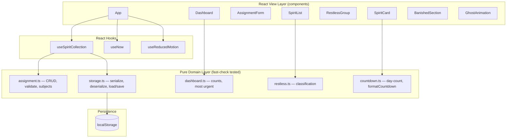
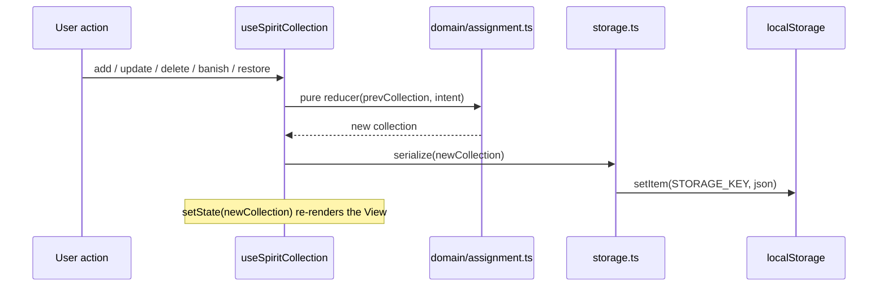

# Design Document — Haunted Study Planner

## Overview

The Haunted Study Planner is a single-page, client-only React + Vite application that tracks student assignments with a Halloween theme. Each assignment is a "spirit"; completing it "banishes" it with a short ghost animation into a separate Banished section from which it can be restored. Deadlines show a spooky countdown that accounts for both date and time of day, and overdue uncompleted work becomes a "restless ghost" shown in a distinct group at the top of the list. A dashboard summarizes spirits banished, spirits remaining, and the most urgent spirit. All state lives in `localStorage`; there is no backend and no login, and the build is a static bundle deployable for free on Vercel or Netlify.

The design separates a **pure domain layer** (no React, no I/O) from a **React view layer**. The domain layer contains every behavior that varies meaningfully with input — countdown day-counting, restless classification, most-urgent selection, CRUD reducers, and serialization — and is the target of property-based testing. The view layer is responsible only for rendering that state, capturing user intent, and syncing to `localStorage`; it is tested with example-based component and accessibility tests. This separation is the central design decision and is what makes the feature's universal properties cheap to verify.

**Tech stack:** React 18 + Vite, plain CSS (no Tailwind/styled-components), a gothic Google Font, `localStorage` for persistence, Vitest + React Testing Library + fast-check for tests. TypeScript is assumed for the signatures below; they are illustrative and can be followed in plain JS with JSDoc.

## Architecture

The application is one view (no client-side router). A single view avoids the SPA-fallback/redirect configuration that multi-route Vite apps need on Vercel and Netlify, so static hosting of `dist/` works with zero server config.



### Layering rules

- **Domain layer** (`src/domain/*`) is pure: functions take data in, return data out, no `window`, no `localStorage`, no React. This is the only layer allowed to encode business rules. It is the sole target of property-based tests.
- **Hooks layer** (`src/hooks/*`) adapts the domain to React: holds the collection in state, derives `now` on a timer, reads `prefers-reduced-motion`, and delegates mutations to domain reducers. The hook is where persistence side effects happen.
- **View layer** (`src/components/*`) renders props/state and emits intents (add/edit/delete/banish/restore). It contains no business logic; it calls domain helpers only for presentation (e.g. `formatCountdown`, `priorityLabel`).

### Assignment lifecycle and classification

```mermaid
stateDiagram-v2
  [*] --> Active: create
  Active --> Restless: now passes dueDate (auto-refresh)
  Restless --> Active: edit dueDate forward
  Active --> Banishing: banish (click)
  Restless --> Banishing: banish (click)
  Banishing --> Banished: animation ends (<=2s) / reduced-motion: immediate
  Banished --> Active: restore
  note right of Restless: uncompleted + overdue; shown in Restless_Group at top
  note right of Banished: completed; shown in Banished_Section, distinct from active list
```



The countdown/classification decision for an uncompleted assignment given `now`:

```mermaid
flowchart TD
  Start([uncompleted assignment, now]) --> C{dueDate < now?}
  C -- yes --> Restless["Restless_Ghost: 'Restless' indicator"]
  C -- no --> D{calendarDaysBetween(now, due) > 0?}
  D -- yes --> Future["'Rises in N days'"]
  D -- no --> Tonight["'Rises tonight at HH:MM'"]
```

Both "earlier calendar day" and "current day with time already passed" reduce to the single timestamp test `dueDate < now`, which is exactly Requirement 8.3's "earlier than the current date and time". Calendar-day counting (`calendarDaysBetween`) is used only for the future-day `N`.

### Persistence data flow



On load the flow inverts: `storage.loadCollection(localStorage)` reads and validates; on any failure it returns `[]` (Requirements 5.3, 5.4).

### Design decisions and rationale

1. **Pure domain layer.** Keeps every input-varying behavior free of React and I/O so fast-check can generate inputs freely. This is what makes the round-trip, day-count, most-urgent, restless, and CRUD properties executable as ordinary function tests.
2. **Single view, no router.** A planner has one screen. Removing client-side routing eliminates the Vercel/Netlify deep-link 404 class of problems entirely, keeping deployment a plain static file serve (Requirement 7).
3. **Local-time date handling.** `<input type="datetime-local">` yields `YYYY-MM-DDTHH:mm`, parsed by `new Date(...)` as local time. Comparisons and calendar-day math are all local, so the countdown reflects the student's own clock. Day counts use `startOfDay` + `Math.round` to stay correct across DST transitions.
4. **Two-phase banish.** Completion state is committed *after* the ghost animation finishes (Requirement 2.4), with a 2000 ms safety fallback so the persisted state is never delayed beyond the 2 s cap even if the `animationend` event is missed (Requirement 2.2). Under reduced motion the full animation is skipped and the state is committed immediately (Requirement 9.3).
5. **`useSyncExternalStore` for external signals.** Both `localStorage` (a mutable external store) and `prefers-reduced-motion` (via `matchMedia`) are read through `useSyncExternalStore`, which is the React-recommended, SSR-safe way to subscribe to external stores and avoids tearing.
6. **`now` on a 60 s tick plus focus refresh.** `useNow(60_000)` satisfies "at least once per minute" (Requirements 8.1, 8.2); an extra refresh on `window` `focus`/`visibilitychange` keeps counts accurate without waiting up to a minute after returning to the tab.

## Components and Interfaces

### Domain layer (`src/domain/`) — pure, the PBT target

```ts
// priority.ts
type Priority = 'low' | 'medium' | 'high';
const PRIORITY_LABEL: Record<Priority, string> = {
  low: 'Faint', medium: 'Haunting', high: 'Terrifying',
};
function priorityLabel(p: Priority): string;            // Req 1.8
function priorityRank(p: Priority): number;             // low=1, medium=2, high=3 (for tie-break)

// dateUtils.ts
function startOfDay(d: Date): Date;                    // local midnight
function parseDueDate(isoLocal: string): Date;           // new Date(isoLocal), local
function formatTime(d: Date): string;                   // "HH:MM" for "Rises tonight at ..."

// countdown.ts — Req 3
function calendarDaysBetween(now: Date, due: Date): number;   // startOfDay diff, Math.round / DAY_MS
function isRestless(due: Date, now: Date): boolean;            // due.getTime() < now.getTime()
function formatCountdown(now: Date, due: Date): string;        // "Rises in N day(s)" | "Rises tonight at HH:MM" | "Restless"

// restless.ts — Req 3.4, 8.3
function isRestlessGhost(a: Assignment, now: Date): boolean;  // !a.completed && isRestless(parseDueDate(a.dueDate), now)

// assignment.ts — Req 1, 2
interface AssignmentInput { title: string; subject: string; dueDate: string; priority?: Priority; }
function validateAssignment(input: AssignmentInput): { valid: boolean; errors: Partial<Record<'title'|'dueDate', string>> };
function createAssignment(input: AssignmentInput): Assignment;        // id=uuid, priority default 'medium', completed=false, completedAt=null
function updateAssignment(c: Assignment[], id: string, patch: Partial<AssignmentInput>): Assignment[];
function deleteAssignment(c: Assignment[], id: string): Assignment[];
function banish(c: Assignment[], id: string, now: Date): Assignment[];     // completed=true, completedAt=iso(now)
function restore(c: Assignment[], id: string): Assignment[];               // completed=false, completedAt=null
function collectSubjects(c: Assignment[], prefix: string): string[];       // distinct non-empty subjects containing prefix, Req 1.7

// dashboard.ts — Req 4
function countBanished(c: Assignment[]): number;           // #completed
function countRemaining(c: Assignment[]): number;          # #uncompleted
function selectMostUrgent(c: Assignment[], now: Date): Assignment | null;  // min (dueDate, -priorityRank) over uncompleted; null if none

// storage.ts — Req 5
const STORAGE_KEY = 'haunted-study-planner:v1';
function serialize(c: Assignment[]): string;               // JSON.stringify of normalized collection
function deserialize(raw: unknown): Assignment[];          // validates shape per assignment; throws on invalid
function loadCollection(storage: Storage): Assignment[];   // try { deserialize(JSON.parse(storage.getItem(KEY))) } catch -> []
function saveCollection(storage: Storage, c: Assignment[]): void; // try { storage.setItem(KEY, serialize(c)) } catch (quota) -> swallow + warn
```

### Hooks layer (`src/hooks/`)

```ts
// useSpiritCollection.ts
function useSpiritCollection(): {
  collection: Assignment[];
  add(input: AssignmentInput): { ok: boolean; errors?: ... };
  update(id: string, patch: Partial<AssignmentInput>): void;
  remove(id: string): void;
  banish(id: string): void;   // triggers two-phase animation via callback; commits state on completion
  restore(id: string): void;
};
// Holds collection in useState; on mount loads via loadCollection(localStorage);
// on every collection change calls saveCollection(localStorage, next).

// useNow.ts
function useNow(intervalMs = 60_000): Date;
// useSyncExternalStore over a timer; also re-reads on window focus/visibilitychange.

// useReducedMotion.ts
function useReducedMotion(): boolean;
// useSyncExternalStore over matchMedia('(prefers-reduced-motion: reduce)').
```

### View layer (`src/components/`)

| Component | Responsibility | Traces to |
|---|---|---|
| `App` | Mounts hooks, lays out Dashboard / form / lists / Banished section; owns the banish-animation coordination | 1–9 |
| `Dashboard` | Renders banished count, remaining count, most-urgent title + countdown; "No spirits haunt you" when none | 4 |
| `AssignmentForm` | Title/Subject/Due_Date/Priority inputs, validation messages, subject `<datalist>` autocomplete; used for create and edit | 1.1, 1.4–1.8 |
| `SubjectAutocomplete` | Wraps `<input list>` + `<datalist>` fed by `collectSubjects` | 1.7 |
| `RestlessGroup` | Top group; renders only uncompleted overdue spirits | 3.4, 3.5 |
| `SpiritList` | Active (non-overdue, uncompleted) spirits | 3.5 |
| `SpiritCard` | One assignment: title, subject, themed priority label, `formatCountdown`, edit/delete/banish buttons | 1.8, 3.1 |
| `BanishedSection` | Banished spirits with restore action; visually distinct from active list | 2.5 |
| `GhostAnimation` | Plays the banish animation; honors reduced motion (fade or none); ≤2 s | 2.1–2.3, 9.1 |
| `Countdown` | Renders `formatCountdown(now, due)` text; restyled for restless | 3.1–3.4 |

### Banish two-phase coordination (Requirement 2.1–2.4, 9.1, 9.3)

```
onBanish(id):
  if useReducedMotion():
    commitBanish(id)              // setCompleted + persist immediately
  else:
    setAnimating(id, true)        // card stays visible (Req 2.3)
    start GhostAnimation (duration ANIMATION_MS <= 2000)
    on animationend OR 2000ms fallback timer:
      commitBanish(id)             // persist after animation (Req 2.4)
      setAnimating(id, false)
```

`ANIMATION_MS` is a named constant asserted `<= 2000` (Requirement 2.2). The 2000 ms fallback timer guarantees the persisted state lands within 2 s even if `animationend` never fires.

## Data Models

```ts
interface Assignment {
  id: string;            // crypto.randomUUID() — stable across edits (Req 1.2 identity)
  title: string;          // non-empty; trimmed on create/edit (Req 1.4)
  subject: string;        // free text; "" allowed; feeds autocomplete (Req 1.7)
  dueDate: string;        // ISO local "YYYY-MM-DDTHH:mm" from datetime-local input (Req 1.4, 3)
  priority: Priority;     // 'low'|'medium'|'high'; defaults 'medium' when unset (Req 1.6)
  completed: boolean;     // false on create; true while banished (Req 2)
  completedAt: string | null; // ISO timestamp when banished, null when active (Req 2.4)
}

type SpiritCollection = Assignment[];   // the complete set, the unit of persistence
```

**Persisted shape:** `localStorage[STORAGE_KEY]` holds `serialize(collection)` — a JSON array of `Assignment` objects. Versioned key (`:v1`) allows future migrations.

**Equivalence for round-trip (Requirement 5.5):** two collections are equivalent iff they have the same length and, position-by-position, equal `id`, `title`, `subject`, `dueDate`, `priority`, `completed`, `completedAt`. `serialize` normalizes field order so JSON string equality also holds after a round-trip.

**Validation contract (Requirement 1.4, 1.5):** an `AssignmentInput` is valid iff `title.trim() !== ''` and `dueDate` is a non-empty `YYYY-MM-DDTHH:mm` string (both date and time present). `deserialize` rejects any element missing a required field, with a wrong-typed field, or with an empty title; a thrown error from `deserialize` causes `loadCollection` to return `[]` (Requirement 5.4).

## Correctness Properties

*A property is a characteristic or behavior that should hold true across all valid executions of a system — essentially, a formal statement about what the system should do. Properties serve as the bridge between human-readable specifications and machine-verifiable correctness guarantees.*

The domain layer is pure, so each property below is an executable fast-check test. The view, accessibility, deployment, and `localStorage` I/O behaviors are not properties and are covered in Testing Strategy by example/integration/smoke tests instead.

### Property 1: CRUD preserves identity and well-formedness

*For any* collection and any single create / update / delete operation: every assignment **not** targeted by the operation is returned unchanged (same `id` and every field); `create` appends exactly one new assignment with a fresh `id` not already present, `priority` defaulted to `'medium'` when unset, `completed === false`, and `completedAt === null`, and grows the length by exactly one; `delete` removes exactly the target `id` (length decreases by one iff the `id` was present) leaving all others unchanged; `update` changes only the target assignment and preserves its `id`.

**Validates: Requirements 1.1, 1.2, 1.3, 1.6**

### Property 2: Validation rejects exactly the invalid inputs

*For any* title string and due-date string, `validateAssignment` rejects if and only if the title is empty or composed entirely of whitespace, or the due date is missing/incomplete (empty or not a valid `YYYY-MM-DDTHH:mm` with both date and time). A valid input (non-whitespace title + complete due date) is always accepted, regardless of `subject` and `priority`.

**Validates: Requirements 1.4, 1.5**

### Property 3: Subject autocomplete returns exactly the matching distinct subjects

*For any* collection and any prefix string, `collectSubjects(collection, prefix)` returns exactly the set of distinct, non-empty `subject` values that appear in the collection and that contain the prefix (case-insensitive), with no duplicates and no subject not present in the collection.

**Validates: Requirements 1.7**

### Property 4: Themed priority labels are exhaustive and exact

*For any* of the three priority values, `priorityLabel(priority)` returns exactly `"Faint"` for `'low'`, `"Haunting"` for `'medium'`, and `"Terrifying"` for `'high'`.

**Validates: Requirements 1.8**

### Property 5: Future-day countdown day count matches an independent day counter

*For any* `now` and any due date on a future calendar day, `formatCountdown(now, due)` returns `"Rises in N days"` (or `"Rises in 1 day"` when N is 1), where N equals the number of calendar-day boundaries crossed from `startOfDay(now)` to `startOfDay(due)` as computed by an independent reference counter that increments a cursor day-by-day.

**Validates: Requirements 3.2, 3.6**

### Property 6: Same-day, not-yet-due countdown shows "Rises tonight"

*For any* `now` and any due date on the same calendar day as `now` whose time has not yet passed (`due >= now`), `formatCountdown(now, due)` returns text beginning with `"Rises tonight"` and containing the time of day.

**Validates: Requirements 3.3**

### Property 7: Restless classification is exactly "due date is in the past"

*For any* uncompleted assignment and any `now`, the assignment is classified a restless ghost if and only if `parseDueDate(assignment.dueDate) < now`; and when it is, `formatCountdown(now, parseDueDate(assignment.dueDate))` returns `"Restless"`. An uncompleted assignment whose due date is not in the past is never classified restless.

**Validates: Requirements 3.4, 8.3**

### Property 8: Dashboard counts partition the collection

*For any* collection, `countBanished(collection)` equals the number of completed assignments, `countRemaining(collection)` equals the number of uncompleted assignments, and `countBanished + countRemaining` equals the total length of the collection.

**Validates: Requirements 4.1**

### Property 9: Most-urgent selection picks the earliest due date, breaking ties by highest priority

*For any* collection containing at least one uncompleted assignment, `selectMostUrgent(collection, now)` returns the uncompleted assignment that minimizes the lexicographic key `(dueDate, -priorityRank)` — i.e., the earliest `dueDate`, and among all uncompleted assignments sharing that earliest `dueDate`, the one with the highest `priorityRank` (`high > medium > low`). When the collection has no uncompleted assignments, it returns `null`.

**Validates: Requirements 4.2, 4.3**

### Property 10: Banish then restore is a round trip

*For any* assignment in a collection, applying `banish` and then `restore` returns the assignment to the active state: `completed === false`, `completedAt === null`, the assignment is present in the active (uncompleted) set and absent from the banished set, and every other assignment is unchanged. The reverse — `restore` then `banish` — likewise ends in the banished state.

**Validates: Requirements 2.1, 2.6**

### Property 11: Serialization round-trips the collection

*For any* valid collection, `deserialize(serialize(collection))` is equivalent to `collection` (same length, and position-by-position equal `id`, `title`, `subject`, `dueDate`, `priority`, `completed`, `completedAt`).

**Validates: Requirements 5.5**

## Error Handling

- **Validation errors (Req 1.5):** `validateAssignment` returns field-keyed messages; the form renders them inline and blocks the save. No partial assignment is created.
- **Corrupted `localStorage` (Req 5.4):** `deserialize` throws on missing/wrong-typed fields, empty title, or bad JSON; `loadCollection` catches every error and returns `[]`, so the app always starts in a known state. The corrupted value is left in place (not silently overwritten until the next mutation).
- **`localStorage` quota / unavailable (e.g., private mode):** `saveCollection` wraps `setItem` in `try/catch`, swallows the `QuotaExceededError`, and surfaces a non-blocking toast ("Spirits couldn't be saved — storage is full"). In-memory state stays correct for the session.
- **Missing `datetime-local` support:** older browsers fall back to a text input; `validateAssignment` still enforces a complete `YYYY-MM-DDTHH:mm` string before saving.
- **Timezone / DST:** all parsing is local; `calendarDaysBetween` uses `startOfDay` + `Math.round` so a 23/25-hour DST day still yields the correct integer day count.
- **No uncompleted assignments (Req 4.4):** `selectMostUrgent` returns `null`; the Dashboard renders `"No spirits haunt you"`.
- **Empty `localStorage` (Req 5.3):** `loadCollection` returns `[]`; the app shows empty-state guidance for spirits and the Banished section is hidden.
- **Missed `animationend` (Req 2.2):** the 2000 ms fallback timer commits the banished state, so a flaky animation never strands an assignment mid-banish.
- **Reduced motion (Req 9.1–9.3):** `useReducedMotion` swaps the full ghost animation and all decorative animations for a fade or none, and the banish state still commits and persists without waiting on the animation.

## Testing Strategy

**Dual testing approach.** Property-based tests verify universal properties of the pure domain layer across generated inputs; example-based unit, component, integration, and smoke tests cover specific scenarios, UI rendering, accessibility, external I/O, and deployment. The two are complementary: properties guard generality, examples pin concrete behavior.

### Property-based tests (fast-check + Vitest)

- Target: `src/domain/*` only (pure functions).
- Library: `fast-check` via `@fast-check/vitest` (`testProp`) or plain `fc.assert(fc.property(...))` inside Vitest.
- **Minimum 100 iterations per property** (`fc.assert(..., { numRuns: 100 })`).
- One property-based test per correctness property above (Properties 1–11).
- Each test is tagged with a comment referencing the design property:
  `// Feature: haunted-study-planner, Property {n}: {property text}`
- Arbitraries: `fc.record` for `Assignment` (uuid via `fc.uuid`, non-empty title via filtered `fc.string`, `priority` via `fc.constantFrom('low','medium','high')`, `dueDate` via generated `YYYY-MM-DDTHH:mm` strings or `fc.date` formatted); `fc.array` for collections; `fc.date` for `now`; reference day-counter as an oracle for Property 5.
- Property 5 uses an independent day-counter oracle; Property 9 uses a reference sort by `(dueDate, -priorityRank)` as an oracle; Property 11 uses the structural equivalence defined in Data Models.

### Unit tests (Vitest)

- `validateAssignment`: empty / whitespace-only title rejected; complete and incomplete due dates; valid input accepted.
- `formatCountdown`: "Rises in 1 day", "Rises in 2 days", "Rises tonight at 14:30", "Restless" boundary cases; DST edge day.
- `priorityLabel`: the three themed names.
- `collectSubjects`: prefix filtering, dedup, empty-subject exclusion.
- `loadCollection` / `saveCollection` (mock `Storage`): empty key → `[]`; valid → collection; invalid JSON / missing fields / wrong types → `[]`; quota error swallowed.

### Component tests (Vitest + React Testing Library)

- `AssignmentForm`: submits valid input → `add` called; empty title → inline message + no `add`; priority unset → created with `'medium'`.
- `SubjectAutocomplete`: `<datalist>` options equal `collectSubjects` output.
- `SpiritCard` / `RestlessGroup` / `SpiritList` / `BanishedSection`: overdue items render only in `RestlessGroup` at the top; banished only in `BanishedSection`; banish then restore returns to active.
- `Dashboard`: counts reflect collection; most-urgent title + countdown; `"No spirits haunt you"` when none; updates after a store mutation (Req 4.5).
- `GhostAnimation`: two-phase banish commits persisted state after `animationend`; the 2000 ms fallback commits if `animationend` is absent; `ANIMATION_MS <= 2000`.
- `useNow` (fake timers): countdown re-renders within 60 s (Req 8.1, 8.2).

### Integration / smoke tests

- `localStorage` round-trip in jsdom: create assignments, unmount/remount, assert state restored (Req 5.1, 5.2).
- Corrupted-data paths (Req 5.4): seed invalid JSON, missing-field objects, wrong-typed fields → app starts empty.
- Reduced motion (Req 9.1–9.3): mock `matchMedia('(prefers-reduced-motion: reduce)')`; banish commits + persists promptly without the full animation; decorative animations use a fade or none.
- **Build smoke (Req 7.1):** CI runs `vite build`; assert `dist/` exists and contains only static assets (no server expected).
- **Deploy smoke (Req 7.2):** deploy `dist/` to a static host; verify the app loads and CRUD works using static files + `localStorage` alone.

### Accessibility tests (Requirements 6.3–6.5, 9)

- Keyboard: tab through form and cards; every control focusable and operable; visible focus indicator present (`:focus-visible`).
- Contrast: axe-core or manual check confirming ≥ 4.5:1 text/background contrast across the purple-and-orange palette.
- Reduced motion: covered above; assert CSS `@media (prefers-reduced-motion: reduce)` overrides suppress non-essential motion.

### Visual / responsive (Requirements 6.1, 6.2, 6.6)

- Snapshot of themed palette tokens and font application (gothic Google Font for headings and body).
- Render at mobile viewport widths; assert no horizontal overflow / scrolling (Req 6.6). These are visual checks, not properties, because "looks spooky and usable" is not a computable universal predicate.

### Why PBT applies here

The domain layer is composed of pure functions with clear input/output behavior (reducers, a day-count algorithm, a selection algorithm, serializers) operating over a large input space (arbitrary collections, dates, strings). That is exactly where property-based testing is strongest, and the requirements themselves state universal properties (the "FOR ALL … SHALL equal" clauses in 3.6, 5.5, and 8.3). UI rendering, CSS theming, accessibility, and static deployment are deliberately excluded from PBT per the standard exclusions and are covered by the example/snapshot/smoke tests above.
